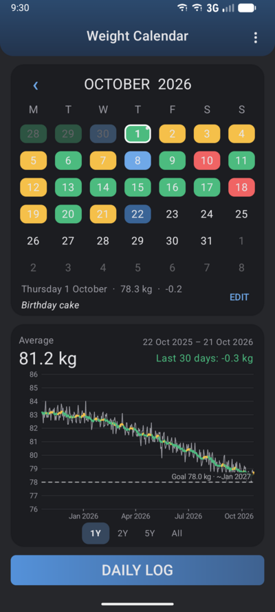
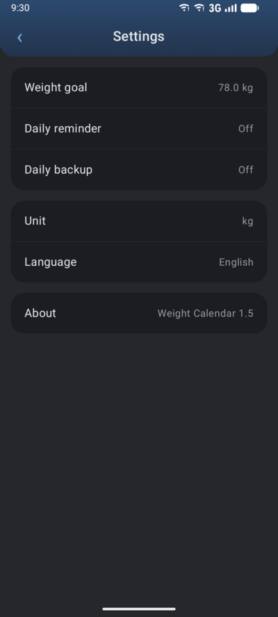

# Weight Calendar

A simple Android app to log your weight every day and see where it is going.
A month calendar coloured by the change from the day before, a graph with smoothed
trends over 1, 2, 5 years or everything, an optional goal with an estimated date,
notes, reminders and automatic backups. Your data stays on your phone.

<p align="center">
  
  
  
  
</p>

## Features

- **One tap a day**: *DAILY LOG* opens a small pop-up for today's weight and an optional note.
- **Coloured calendar**: each day shows the change since the day before.

  | Colour | Change from the previous day |
  |---|---|
  | 🔵 Blue | −0.5 kg or more lost |
  | 🟢 Green | 0 to −0.5 kg |
  | 🟡 Yellow | up to +0.5 kg |
  | 🔴 Red | +0.5 kg or more gained |

- **Missing days are estimated**: a forgotten day is filled with a straight line between
  the days around it, marked with a red ring. Log it later and it becomes a measured day.
- **Graph**: daily weights in light grey with a coloured smoothed trend (7-day average,
  30-day average for long periods). Swipe it to switch between 1, 2, 5 years and all.
  It follows the month shown in the calendar.
- **Goal**: an optional target weight, drawn as a dashed line with the date you would reach
  it at the pace of the last 30 days.
- **Notes** on any day (a dot marks the days that have one).
- **Daily reminder** if today's weight is not logged yet.
- **Backups**: CSV export and import by hand, plus an optional daily backup to a folder of
  your choice, which a sync app (cloud, NAS) can copy. The 14 latest are kept.
- **kg or lb**, and **5 languages**: English, French, Norwegian (bokmål), German, Spanish.

The full description is in the [user guide](docs/USER_GUIDE.md).

## Privacy

Weight Calendar has **no internet permission**: it cannot send anything anywhere. There is no
account, no ads, no tracking. The data lives in the app's database on your phone, and in the
CSV files you choose to export. Android's automatic cloud backup is turned off on purpose:
backups are yours to make (see *Daily backup* in the settings).

## Install

Weight Calendar is not on the Play Store. To install it:

1. Download the latest `WeightCalendar-x.y.apk` from the
   [Releases page](https://github.com/jnegrel/android-weight-calendar/releases).
2. Open it on your phone. Android asks to allow installing apps from this source
   (your browser or file manager): allow it once.
3. Android may show a Play Protect warning, since the app doesn't come from the Play Store:
   choose *Install anyway*.

**Updates**: install the new APK over the old one; Android offers *Update* and your data is
kept. To be told about new versions automatically, you can add this repository to
[Obtainium](https://github.com/ImranR98/Obtainium).

Requires Android 8.0 or newer. Choosing the app's language separately from the phone's
needs Android 13 or newer.

## Build from source

You need [Android Studio](https://developer.android.com/studio) (it includes the Java
runtime and the Android SDK). Open the project folder and press ▶ *Run*, or from a terminal:

```bash
./gradlew assembleDebug              # app/build/outputs/apk/debug/app-debug.apk
./gradlew testDebugUnitTest          # fast tests, on the computer
./gradlew connectedDebugAndroidTest  # tests on a connected device or emulator
```

The debug build is called *Weight Cal. (debug)* and installs next to the release app, so it
can be tried without touching your real data.

How the code is organised, how to add a language and how releases are made:
[architecture notes](docs/ARCHITECTURE.md).

## Licence

Copyright © 2026 Jean Negrel.

This program is free software: you can redistribute it and/or modify it under the terms of
the GNU General Public License as published by the Free Software Foundation, either version 3
of the License, or (at your option) any later version. It is distributed in the hope that it
will be useful, but WITHOUT ANY WARRANTY; see the [LICENSE](LICENSE) file for details.

The app was developed with the help of Claude (Anthropic), as a way to learn Android
development.
