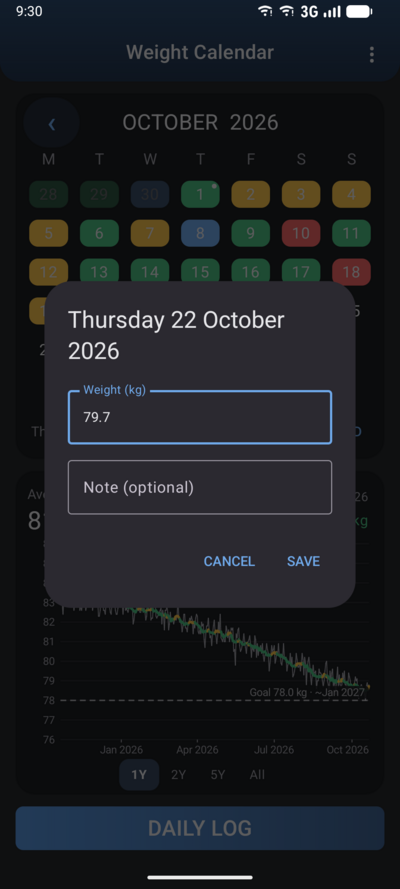
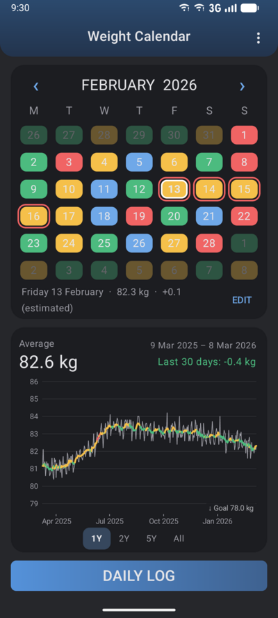
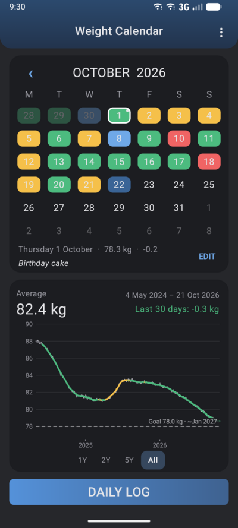

# Weight Calendar – User guide

- [Logging your weight](#logging-your-weight)
- [The calendar](#the-calendar)
- [The graph](#the-graph)
- [Settings](#settings)
- [Backups and CSV files](#backups-and-csv-files)
- [Tips](#tips)

## Logging your weight

Tap **DAILY LOG** at the bottom of the screen. A pop-up opens for today:



- **Weight**: one decimal, with a dot or a comma (`80.4` or `80,4`), in kg or lb depending
  on the [unit](#unit). Values outside 20–400 kg are refused.
- **Note** (optional): one line, up to 200 characters. For instance "Restaurant",
  "After running", "New scale".

To add, change or delete **another day**, tap it in the calendar, then **ADD** or **EDIT**
under the calendar. **DELETE** appears for days you measured.

## The calendar

Each day you logged is coloured by its change from the day before:

| Colour | Change (Δ) from the previous day |
|---|---|
| 🔵 Blue | Δ ≤ −0.5 kg |
| 🟢 Green | −0.5 kg < Δ ≤ 0 |
| 🟡 Yellow | 0 < Δ < +0.5 kg |
| 🔴 Red | Δ ≥ +0.5 kg |
| ⚪ Grey | the very first day (nothing to compare with) |

The thresholds stay the same in lb (0.5 kg ≈ 1.1 lb).

- **Today** is dark blue until you log it; the **selected day** has a white border.
- **Estimated days** have a **red ring**. When you skip one or more days, the app fills
  them with a straight line between the measured days around them, so that the colours and
  the graph have no holes. They follow automatically if you change a measured day next to
  them. Logging an estimated day turns it into a measured day; deleting a measured day
  between two others turns it back into an estimated one.
- A **small white dot** in the corner means the day has a **note**.
- The line under the calendar shows the selected day: weight, change, note.
- Days of the previous and next month are shown **dimmed**. Tap one to go to its month.
- Change month with the **‹ ›** arrows or by **swiping** sideways.



## The graph

- The **light grey line** shows your daily weights (for 5 years and all: the 7-day average,
  as a year of daily weights would be an unreadable band).
- The **thick coloured line** is the smoothed trend: the 7-day average on 1 year, the
  30-day average on longer periods. Each average is *centred* (the day and as many days
  before as after), so the last few points still move a little as you log new days.
  Its colour uses the same four colours, applied to the change **per week**:
  blue when losing 0.5 kg/week or more, green for a slower loss, yellow for a slow gain,
  red for 0.5 kg/week or more.
- **Period**: swipe the graph left/right, or tap **1Y · 2Y · 5Y · All** under it.
- The graph **follows the calendar**: it ends with the month displayed (at your last weight
  for the current month), so you can look at any past year.
- The header shows the **average** weight over the period, the dates, and the change of the
  last 30 days (of the 7-day average).
- With a [goal](#weight-goal), a **dashed line** shows it, labelled with the estimated date
  you would reach it: the last 30 days' pace, carried on. No date is shown if the trend
  moves away from the goal, "> 5 years" if it is very far, "reached" within 0.2 kg.
  When the goal is outside the graph, its label sits at the top or bottom edge with an arrow.



## Settings

Open them with **⋮ → Settings**.

### Weight goal
The weight you aim for. **REMOVE** deletes it.

### Daily reminder
A notification at the time you choose, **only if today's weight is not logged yet**.
It disappears as soon as you log today. Android asks once for the permission to show
notifications. The time is approximate: Android may delay it by a few minutes to save
battery.

### Daily backup
Once a day, the app writes a full CSV backup (the same file as *Export CSV*) into a folder
you choose, and keeps the **14 latest**. Tap **CHOOSE**, pick or create a folder (for
example `Documents/WeightCalendar`; Android doesn't allow `Download` itself), and allow
access. **BACK UP NOW** writes one immediately; *Last backup* tells when it last worked.

The backups are named `weightcal-backup-YYYY-MM-DD.csv`. Files with other names, such as
your manual exports, are never deleted.

To keep a copy off the phone, let a sync app copy this folder: a cloud app (Google Drive,
Nextcloud…) or your NAS's backup app.

### Unit
Kilograms or pounds. Only the display changes: the data is always stored in kg, so you can
switch back and forth freely.

### Language
Opens Android's page to choose the app's language independently of the phone's
(Android 13 and newer). Available: English, French, Norwegian (bokmål), German, Spanish.

### Source code
Opens the project page on GitHub.

## Backups and CSV files

**⋮ → Export CSV** saves everything (all days and the settings) to a file of your choice.
**⋮ → Import CSV** reads such a file back: its days are added, or replace the same dates.
Days not in the file are kept. If the file contains settings, they are applied too.

The format is plain text, readable in any spreadsheet:

```
# Weight Calendar backup. Lines starting with # are settings.
# goal_kg=78.0
# reminder_on=1
# reminder_time=08:00
# unit=kg
date,weight_kg,estimated,note
2026-10-01,78.30,0,Birthday cake
2026-10-02,78.80,0,
2026-10-03,78.65,1,
```

- `weight_kg` is always in kg, with a dot; `estimated` is 1 for estimated days, 0 otherwise.
- A note containing a comma, semicolon or quote is written between quotes (`"Pizza, wine"`),
  as spreadsheets do.
- The import also accepts what a spreadsheet saves in many European languages: `;` as
  separator, decimal comma, dates as `day/month/year`. Files from older versions (without
  settings or notes) work too.
- To read the file with Python: `pandas.read_csv("weights.csv", comment="#")`.

## Tips

- **Before installing a new version**, export a CSV: updates keep your data, but a backup
  costs nothing.
- **New phone**: install the app, then import your last backup: days and settings come back.
  Choose the backup folder again in the settings.
- **Weigh yourself in the same conditions** (same time, same scale): the daily line varies
  by ±1 kg anyway (water, meals). That's what the smoothed trend is for: look at it rather
  than at a single day.
